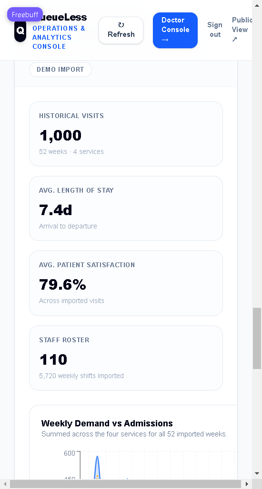

# QueueLess 🏥
### Intelligent Hospital Queue & Patient Flow Management System

<div align="center">

[](https://queueless-web.onrender.com)
[](https://github.com/WARRIORXR/Hospital-Management)
[](https://queueless-api-lvf5.onrender.com)
[](https://queueless-api-lvf5.onrender.com/docs)

</div>

---

### 🌐 Live Application
👉 **[https://queueless-web.onrender.com](https://queueless-web.onrender.com)**

> **Experience QueueLess Live:** The application is deployed and running live at **[https://queueless-web.onrender.com](https://queueless-web.onrender.com)**. Choose your section (Patient, Staff, Hospital, or Admin) to access real-time hospital queues, OPD wait-time estimation, and management consoles.

---

## 📖 About QueueLess

**QueueLess** is an intelligent, full-stack hospital outpatient department (OPD) queue and patient flow management system. It was designed from the ground up to solve long waiting room bottlenecks, chaotic queuing, and lack of operational transparency in outpatient healthcare facilities.

### 🎯 Core Objectives & Solutions
- **Zero Blind Waiting:** Patients view real-time queue lengths, doctor availability, and estimated consultation wait times before and during their hospital visit.
- **Priority-Aware Clinical Triage:** The queue automatically prioritizes patients based on clinical urgency (`Emergency` > `Elderly` / `Pregnant` > `Follow-up` > `Regular`), ensuring critical cases are seen first.
- **Dual-Backend High-Performance Architecture:** Features a native **Rust (Axum + Tokio + SQLx)** backend delivering ultra-low memory consumption (~12MB RAM) and sub-millisecond execution, alongside a full-featured **Python (FastAPI + SQLAlchemy)** API.
- **Role-Based Portals:** Dedicated, secure consoles for Patients, Medical Staff, Hospital Managers, and System Administrators.
- **Bilingual Accessibility:** Native one-click toggle between English and Hindi across patient-facing interfaces.

---

### ⚡ Rust vs. Python Performance Benchmarks

QueueLess provides two backend implementations. Real benchmark comparisons on local runtime:

| Metric | Python (FastAPI + SQLAlchemy) | Rust (Axum + SQLx) | Improvement |
| :--- | :--- | :--- | :--- |
| **RAM Footprint** | `84.12 MB` | **`12.56 MB`** | **~85% memory reduction** (7x lighter) |
| **Cold Start / Initialization** | ~`1,500 ms` | **`19 ms`** | **~78x faster boot time** |
| **Compiled Binary Size** | — | **`5.9 MB`** (release) | Ultra-compact deployment |
| **Throughput / Execution** | GIL bytecode | Native machine code + async epoll/IOCP | High concurrent capacity |

---

---

## 🚀 Key Features

- **📱 Patient Self-Service Portal**
  - Server-issued OTP verification with expiry, resend cooldown, and attempt limits.
  - Department selection with real-time OPD status and doctor availability.
  - Priority category selection (Emergency, Elderly, Pregnant, Follow-up, Regular).
  - Instant token generation with live queue position and estimated wait time tracking.
  - Printable token slip and self-service "leave queue" cancellation.
  - Token and queue lookup by registered phone number.
  - One live token per phone number, so patients cannot double-book.

- **🩺 Doctor & Staff Portal**
  - Department-specific queue dashboard scoped to the current hospital day.
  - Priority-based patient queue with "Call Next", "Start Consultation", "Complete", "Skip", and "Cancel" actions.
  - Requeue action restores a skipped/cancelled patient to the waiting queue.
  - Room-occupancy guard: only one patient can be called into a department at a time.
  - Real-time doctor availability toggle.

- **📊 Admin Operations Dashboard**
  - Hospital-wide operational metrics: total registrations, active consultations, waiting patients, and completed visits.
  - Department workload distribution and bottleneck indicators.
  - Visual analytics for patient flow and department performance.
  - Historical dataset section: 1,000 imported visits, 52-week demand vs admissions, service performance, roster attendance and the import quality report.

- **⚡ Priority-Aware Queue Algorithm**
  - Intelligent queue ordering based on clinical priority (Emergency > Pregnant/Elderly > Follow-up > Regular).
  - Dynamic estimated wait time calculations based on active consultations and queue length.
  - Tokens restart at #1 for each department every hospital day.

- **🌐 Bilingual Patient Experience (English & हिन्दी)**
  - Seamless one-click language switcher between English and Hindi across all patient flows (landing page, OTP verification, department selection, and live token receipts).
  - Culturally accessible terminology tailored for outpatient departments.

- **🔒 Consistency & Safety Rules**
  - Visit state machine (waiting → called → consulting → completed) rejects invalid transitions.
  - Duplicate active registrations return the patient's existing token instead of issuing a new one.
  - Live queue operations (call-next, room guard, wait estimates) are scoped to the hospital day — stale visits from previous days can never join or block today's queue.
  - Day-scoped analytics use real registration timestamps in hospital (IST) time.

---

## 🛡️ Security, Privacy & Data Retention

- **Role enforcement, twice.** Portals gate on the signed-in role and every API route re-checks it server-side (`require_role`, `require_patient_token`, `claims_may_access`) — opening a console URL directly cannot bypass it.
- **Hardened OTP flow.** Codes expire after 5 minutes, allow 5 verification attempts, enforce a per-phone resend cooldown, and are additionally rate-limited **per client IP** (`OTP_REQUEST_IP_LIMIT` / `OTP_VERIFY_IP_LIMIT`) so rotating phone numbers cannot sidestep the limits.
- **Privacy policy & consent.** The public OPD board shows only department/doctor/room/queue-length data — never patient names, phones, or symptoms (covered by automated tests). Patients see a consent notice at registration and the policy lives at [`/privacy`](http://localhost:3000/privacy) (English + हिन्दी), including DPDP Act 2023 rights.
- **Data retention.** Live visit records are purged after 90 days by default (`PATIENT_RETENTION_DAYS`, `0` disables). The historical admin dataset is synthetic demo data, not real patient records.
- **Operational notes for real deployments:** register a DLT-approved SMS sender ID and templates in India before sending real OTPs, and appoint a DPDP grievance contact.

---

## 🔐 Portals & Access

QueueLess ships four separate sections. `/sections` is the hub; each section has its own sign-in and only exposes what its role allows.

| Section | Sign in at | Credentials | Can do |
| --- | --- | --- | --- |
| **Patient** | `/login/patient` | 10-digit mobile + OTP | Register a token, track position, leave the queue, read only their own visits |
| **Staff** | `/login/staff` | Employee code + PIN | Call, consult, complete, skip or requeue patients; toggle doctor availability |
| **Hospital** | `/login/hospital` | Employee code + PIN | Manage departments, doctors, OPD hours and availability |
| **Admin** | `/login/admin` | Employee code + PIN | Hospital-wide analytics, bottleneck oversight, plus hospital and staff consoles |

Employee logins are created on first backend start and can be overridden with environment variables:

| Section | Variables | Development default |
| --- | --- | --- |
| Admin | `ADMIN_CODE` / `ADMIN_PIN` | `ADM-001` / `123456` |
| Hospital | `HOSPITAL_CODE` / `HOSPITAL_PIN` | `HOSP-001` / `123456` |
| Staff | `STAFF_CODE` / `STAFF_PIN` | `DR-101` / `123456` |

Each section verifies the role twice: the login response must match the section the employee
opened (a Hospital code tried on `/login/admin` is rejected and linked to its own section), and
the API enforces the same matrix through `require_role`, `require_patient_token` and
`claims_may_access` — so opening a console URL directly still cannot bypass it.

Sessions are signed JWTs. Set `AUTH_SECRET` in production; without it the backend generates an
ephemeral per-process secret, so employees are signed out whenever the API restarts.

---

## 🛠️ Tech Stack

### Frontend
- **Framework:** Next.js (App Router, TypeScript, React 19)
- **Styling:** Tailwind CSS, Lucide Icons
- **HTTP Client:** Fetch API with centralized API utilities and bilingual i18n support

### Backend Services (Dual Options)
- **⚡ Rust Backend (`backend_rust`):**
  - **Framework:** Axum 0.7 (Tokio async runtime)
  - **Database:** SQLx 0.8 (compile-time verified queries, SQLite & PostgreSQL ready)
  - **Security:** PBKDF2-HMAC-SHA256 password hashing, HS256 JWT tokens
  - **Performance:** ~12MB RAM, 19ms cold boot, 5.9MB release binary
- **🐍 Python Backend (`backend`):**
  - **Framework:** FastAPI (Python 3.10+ ASGI with Uvicorn)
  - **ORM / Database:** SQLAlchemy 2.0 with PostgreSQL (Production) / SQLite (Local Fallback)
  - **Validation:** Pydantic 2.0 models
  - **Test Suite:** 53 passing automated pytest test cases

---

## 📂 Project Structure

```text
Hospital-Management/
├── backend_rust/          # ⚡ High-performance native Rust service (Axum + SQLx)
│   ├── src/
│   │   ├── auth.rs        # PBKDF2 hashing & JWT token verification
│   │   ├── db.rs          # Database pooling, migrations & seeding
│   │   ├── handlers.rs    # Complete REST endpoints (matching frontend contracts)
│   │   ├── models.rs      # Data models and DTO structs
│   │   └── main.rs        # Axum router, CORS layer & server listener
│   ├── Cargo.toml         # Rust crate dependencies
│   ├── Dockerfile         # Multi-stage optimized Docker build (<30MB image)
│   └── README.md          # Rust backend guide & benchmarks
├── backend/               # 🐍 Python FastAPI service
│   ├── models/            # SQLAlchemy database models (queue + demo history)
│   ├── schemas/           # Pydantic request/response schemas
│   ├── demo_data/         # Checked-in historical hospital CSVs
│   ├── tests/             # Pytest API and dataset suites (53 tests)
│   ├── database.py        # Database connection & session management
│   ├── import_demo_data.py# Idempotent historical dataset importer
│   ├── main.py            # FastAPI routes, endpoints & seeding
│   ├── requirements.txt   # Python dependencies
│   └── .env.example       # Backend environment variables template
├── frontend/              # 🌐 Next.js Bilingual Web Application
│   ├── app/
│   │   ├── page.tsx       # Primary homepage: Sections Portal Hub
│   │   ├── opds/          # Live OPD transparency board
│   │   ├── admin/         # Admin analytics & dataset console
│   │   ├── doctor/        # Doctor consultation & queue management
│   │   ├── hospital/      # Hospital ops & department schedule manager
│   │   ├── login/[section]/ # Role-based portal authentication
│   │   ├── sections/      # Portal navigation directory
│   │   ├── register/      # Patient OPD registration
│   │   ├── queue/[id]/    # Live queue tracking & token slip
│   │   ├── verify/        # Mobile OTP verification
│   │   ├── privacy/       # Privacy policy & data retention (EN + हिन्दी)
│   │   ├── opengraph-image.tsx # Generated social-share card
│   │   └── check-token/   # Token lookup by phone number
│   ├── lib/               # Shared utilities & API client
│   ├── package.json       # Node dependencies
│   └── .env.local.example # Frontend environment variables template
├── render.yaml            # Render Blueprint deployment definition
├── DEPLOY_RENDER.md       # Render deployment instructions
├── DEPLOY_CLOUDFLARE.md   # Cloudflare Pages deployment guide
├── PROJECT_SYNOPSIS.md    # Academic synopsis & architecture document
└── README.md
```

---

## ⚙️ Getting Started

### Prerequisites
- **Node.js 18+ & npm**
- **Python 3.10+** (if running Python backend)
- **Rust & Cargo 1.80+** (if running Rust backend)
- **Git**

---

### 1. Backend Setup

You can choose either the **Rust** or **Python** backend:

#### Option A: Running the High-Performance Rust Backend ⚡
```bash
cd backend_rust
cargo run --release
```
*Server will start instantly on `http://127.0.0.1:8001` (or `PORT=8000`). Consumes only ~12MB RAM!*

#### Option B: Running the Python FastAPI Backend 🐍
```bash
cd backend

# Create and activate virtual environment
python -m venv venv
# Windows:
.\venv\Scripts\activate
# Linux/macOS:
source venv/bin/activate

# Install dependencies & run
pip install -r requirements.txt
uvicorn main:app --reload --port 8000
```
*Backend API will be accessible at: `http://127.0.0.1:8000` | Swagger Docs: `http://127.0.0.1:8000/docs`*

---

### 2. Frontend Setup

```bash
cd frontend

# Install dependencies
npm install

# (Optional) Configure environment variables
cp .env.local.example .env.local

# Run development server
npm run dev
```
Frontend application will be accessible at: `http://localhost:3000`

---

### 3. Running the Backend Tests

The API ships with an end-to-end pytest suite that runs against a throwaway SQLite database.

```bash
cd backend
pip install -r requirements-dev.txt
python -m pytest tests -q
```

Coverage includes OTP issuance/verification, duplicate registrations, the full visit flow,
priority dispatch, room-occupancy conflicts, requeue, daily token reset, and analytics shape.
The demo import has its own suite (`tests/test_demo_data.py`) that checks row counts,
referential integrity, idempotency, registration into imported departments, and admin-only
access to the dataset summary.

The frontend is checked with TypeScript and a production build:

```bash
cd frontend
npx tsc --noEmit
npm run build
```

---

### 4. Loading the Historical Demo Dataset

The `backend/demo_data/` folder ships a hospital dataset used to populate the app with realistic
history and a live queue:

| File | Rows | Contents |
| --- | --- | --- |
| `patients.csv` | 1,000 | Completed inpatient visits, Jan 2025 – Jan 2026 |
| `services_weekly.csv` | 208 | 52 weeks × 4 services: beds, requests, admissions, refusals, satisfaction, morale, events |
| `staff.csv` | 110 | Roster: 18 doctors, 69 nurses, 23 nursing assistants |
| `staff_schedule.csv` | 6,552 | Weekly attendance (126 people × 52 weeks) |

Import it from the backend directory (the importer creates its own tables):

```bash
cd backend
python import_demo_data.py                 # add missing rows and refresh today's demo tokens
python import_demo_data.py --reset         # wipe this dataset first, then re-import
python import_demo_data.py --no-live-queue # history only; leave the live queue alone
python import_demo_data.py --live-per-service 10  # tokens per service for today (default 6)
```

The importer is idempotent: rows are matched by natural key (patient ref, week + service, staff
ref, staff + week), so re-running only refreshes today's demo tokens. A JSON report is printed and
stored in `demo_import_meta`, and the Admin console renders it under **Historical Hospital Dataset**
(visit totals, length of stay, satisfaction, weekly demand vs admissions, service performance,
roster attendance, and the import quality report). The Admin console is available at `/admin`
after signing in with `ADM-001` / `123456` in development.

<p align="center">
  
</p>

**Service mapping.** `emergency`, `surgery`, `general_medicine` and `icu` become first-class
departments (Emergency, Surgery, General Medicine Ward, Intensive Care Unit). Each CSV doctor is
imported as a clinical doctor with an OPD schedule, so the four services appear on the public page,
the staff console and the hospital console. Six dataset visits per service are also seeded as
today's waiting tokens (prefixed phone `90000009`) so the live screens have data; they are
replaced on every import run.

**Data-quality decisions.** `staff_schedule.csv` cannot be joined by id: none of its 126 ids exist
in `staff.csv`, 16 names belong to patients rather than staff, and 77 matched names disagree with
the roster on role/service. The roster is authoritative: shifts are joined by name, the roster's
role/service win, and the 832 rows for the 16 unknown names are rejected and listed in the report.
`patients.csv` and `services_weekly.csv` are validated strictly (ISO dates, departure ≥ arrival,
age 0–120, `requested = admitted + refused`, `admitted ≤ beds`, 0–100 scores) and the import
aborts without writing if any row fails.

---

## 🔌 API Reference (selected)

| Method | Path | Purpose |
| --- | --- | --- |
| `GET` | `/health` | Readiness probe (API + database) |
| `POST` | `/auth/request-otp` | Issue a 6-digit OTP for a mobile number |
| `POST` | `/auth/verify-otp` | Verify an OTP (5 min TTL, 5 attempts) and issue a patient session token |
| `POST` | `/auth/staff-login` | Employee code + PIN sign-in for the admin, hospital and staff sections |
| `GET` | `/hospital/overview` | Departments, doctors and OPD hours for the hospital section |
| `GET` | `/opds` | Public OPD load, wait times, and serving token |
| `POST` | `/patients` | Register a visit and issue a daily token |
| `GET` | `/patients?department=&status=&today=` | Filter queue records |
| `GET` | `/patients/by-phone/{phone}` | Latest/active visit for a mobile number |
| `PUT` | `/patients/call-next?department=` | Priority-aware dispatch |
| `PUT` | `/patients/{id}/consult` \| `/complete` \| `/skip` \| `/cancel` | Visit state transitions |
| `PUT` | `/patients/{id}/requeue` | Return a skipped/cancelled visit to the queue |
| `GET` | `/patients/{id}/queue-status` | Live position and estimated wait |
| `GET` | `/admin/overview` \| `/admin/department-load` \| `/admin/analytics` | Operations dashboards (admin only) |
| `GET` | `/demo/overview` | Historical dataset summary and import quality report (admin only) |

Protected routes return `401` without a session, `403` when the role is wrong, and patient
tokens are scoped to their own mobile number (`403` on another patient's record).

Interactive docs are available at `http://127.0.0.1:8000/docs`.

---

## ☁️ Deployment

### 1. Cloudflare Pages (Frontend Edge CDN) ⛅
The Next.js frontend is deployed globally across Cloudflare's high-speed edge network with automated CI/CD connected to the repository:
- **Live Production URL:** [https://queueless.pages.dev](https://queueless.pages.dev)
- **Automated Deployment:** Pushing commits to `main` triggers automated Cloudflare Pages builds and zero-downtime edge deployments.
- **Build Configuration:**
  - **Framework Preset:** Next.js (Static HTML Export)
  - **Root Directory:** `frontend`
  - **Build Command:** `npm run build` (automatically outputs static export to `out/` via `CF_PAGES=1`)
  - **Output Directory:** `out`
  - **Environment Variables:** `NEXT_PUBLIC_API_URL=https://queueless-api-lvf5.onrender.com`
- **Deployment Guide:** See [DEPLOY_CLOUDFLARE.md](DEPLOY_CLOUDFLARE.md) for step-by-step dashboard connection and Wrangler CLI instructions.
- **Cloudflare Developer Environment:** Equipped with official Cloudflare Agent Skills and remote Model Context Protocol (`https://mcp.cloudflare.com/mcp`) integration in `.vscode/mcp.json`.

### 2. Render Blueprint (Full-Stack Backend & PostgreSQL) 🚀
QueueLess includes an infrastructure-as-code **Render Blueprint** (`render.yaml`) that provisions the FastAPI backend, Next.js frontend web service, and managed PostgreSQL instance:
- **Backend API:** [https://queueless-api-lvf5.onrender.com](https://queueless-api-lvf5.onrender.com)
- **Interactive OpenAPI / Swagger Docs:** [https://queueless-api-lvf5.onrender.com/docs](https://queueless-api-lvf5.onrender.com/docs)
- **Render Web Frontend:** [https://queueless-web.onrender.com](https://queueless-web.onrender.com)
- **Deployment Guide:** See [DEPLOY_RENDER.md](DEPLOY_RENDER.md).

### 3. Vercel Multi-Service Deployment ⚡
QueueLess is also configured for unified Vercel deployment with service bindings between frontend and backend via `vercel.json`.

> [!NOTE]
> The historical demo dataset is not imported automatically on first deploy. To populate a deployed environment, run
> `python import_demo_data.py` once against its database (set `DATABASE_URL` to the deployed
> connection string); until then the app works with the six seeded OPD departments and an empty
> historical section.

---

## 📄 Academic Synopsis

For the complete academic synopsis including problem statement, system architecture, database design, and methodology, see [PROJECT_SYNOPSIS.md](PROJECT_SYNOPSIS.md).

---

## 📜 License

This project is licensed under the MIT License.
